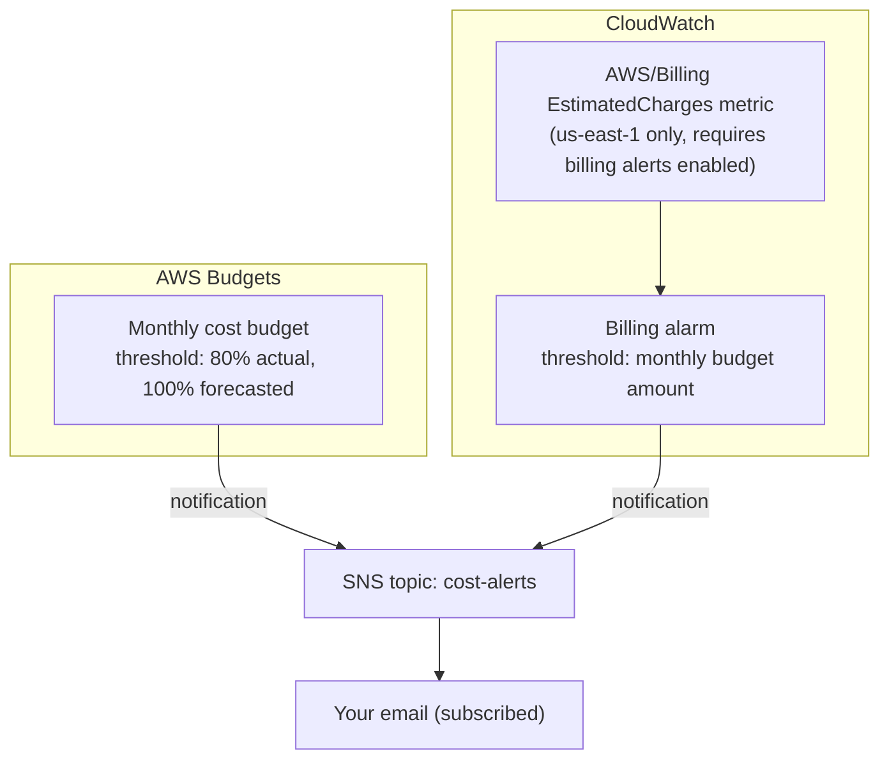

# AWS Cost Monitoring & Alerts

A **AWS Budgets** threshold alert and a **CloudWatch billing alarm**, both notifying an SNS topic/email, plus a clear writeup of four AWS cost tools that the CLF-C02 exam loves to mix up: the **Pricing Calculator**, **Cost Explorer**, **Budgets**, and **CloudWatch billing alarms**. Built while studying the billing/pricing portion of the **AWS Certified Cloud Practitioner (CLF-C02)** exam.

> ⚠️ **Status**: this Terraform configuration was hand-written against the AWS provider docs and reviewed manually; `terraform validate`/`apply` have **not** been run — this environment has no Terraform CLI or AWS credentials. Run it yourself following [Setup](#setup). This is one of the cheapest labs in the portfolio to actually try — read [Cost considerations](#cost-considerations) anyway, it's the whole point of the repo.

## Table of contents
- [Learning objectives](#learning-objectives)
- [Cost estimation vs. cost analysis vs. budget alerts vs. operational monitoring](#cost-estimation-vs-cost-analysis-vs-budget-alerts-vs-operational-monitoring)
- [Use case](#use-case)
- [Architecture](#architecture)
- [Why these services](#why-these-services)
- [Repository structure](#repository-structure)
- [Setup](#setup)
- [Testing](#testing)
- [Cleanup](#cleanup)
- [Cost considerations](#cost-considerations)
- [Security notes](#security-notes)
- [Troubleshooting](#troubleshooting)
- [Limitations & future improvements](#limitations--future-improvements)
- [References](#references)

## Learning objectives

After working through this lab you should be able to:
- Correctly place **AWS Pricing Calculator**, **Cost Explorer**, **AWS Budgets**, and **CloudWatch billing alarms** each in the right stage of the cost lifecycle (before spend / after spend, retrospective / proactive).
- Write an **AWS Budgets** budget with a percentage-of-threshold alert, and explain the difference between an **actual** cost alert and a **forecasted** cost alert.
- Create a **CloudWatch billing alarm** on the `EstimatedCharges` metric, and know the one-time account setting it depends on.
- Explain why Budgets/billing alarms are a safety net, not a cost-control mechanism by themselves — they *notify*, they don't *stop* spend.
- List concrete cost-control actions beyond alerting: Savings Plans/Reserved Instances for steady workloads, right-sizing via Compute Optimizer, S3 lifecycle rules, and tagging for cost allocation.

## Cost estimation vs. cost analysis vs. budget alerts vs. operational monitoring

These four get conflated constantly — and the exam tests the distinction directly:

| Tool | When you use it | Question it answers |
|---|---|---|
| **AWS Pricing Calculator** | **Before** you spend anything | "If I build this architecture, roughly what will it cost per month?" |
| **Cost Explorer** | **After** you've spent money, looking back | "Where did last month's bill actually go, broken down by service/tag/account?" |
| **AWS Budgets** | Ongoing, proactive | "Alert me *before/as* I cross a spending threshold I set." |
| **CloudWatch billing alarms** | Ongoing, metric-based | "Treat estimated charges like any other operational metric — alarm on it, same tooling as CPU or error-rate alarms." |

Budgets and CloudWatch billing alarms look similar (both alert on spend) but come from different product surfaces: Budgets is purpose-built for cost (supports forecasted costs, usage budgets, RI/Savings Plans utilization budgets), while the CloudWatch billing alarm is the general-purpose metrics/alarms system pointed at one specific AWS-published metric. This lab deploys **both**, deliberately, so the difference is concrete rather than just a diagram.

## Use case

An individual or small team wants to know **immediately** — by email — if their AWS spend is trending above what they expect, instead of discovering it when the monthly invoice arrives. This is exactly the "oh no, I forgot to destroy that NAT Gateway" scenario from earlier labs in this portfolio.

## Architecture



## Why these services

| Service | Why it was chosen |
|---|---|
| **AWS Budgets** | Purpose-built for cost thresholds, supports both actual and *forecasted* spend alerts — catches a trend before you've actually overspent. |
| **CloudWatch + SNS** | Demonstrates that billing data is just another CloudWatch metric, usable with the exact same alarm/notification tooling as any other operational metric — a deliberate contrast with Budgets. |
| **SNS** | Decouples "something crossed a threshold" from "how you get notified" — email here, but the same topic could fan out to Slack/Lambda/SMS later with zero change to the alerting resources themselves. |

## Repository structure

```
aws-cost-monitoring-alerts/
├── README.md
├── LICENSE
├── .gitignore
└── terraform/
    ├── main.tf               # SNS topic + subscription, AWS Budget, CloudWatch billing alarm
    ├── variables.tf
    ├── outputs.tf
    └── terraform.tfvars.example
```

## Setup

**Prerequisites**: AWS account, [Terraform](https://developer.hashicorp.com/terraform/install) ≥ 1.5, AWS CLI v2 configured, and — for the CloudWatch billing alarm specifically — **"Receive Billing Alerts" enabled** once, manually, under the root account's [Billing preferences](https://console.aws.amazon.com/billing/home#/preferences) (this is a one-time account setting that cannot be toggled via Terraform/API, only the console, by the root user).

```bash
cd terraform
cp terraform.tfvars.example terraform.tfvars
# edit terraform.tfvars: set alert_email and your real monthly budget_amount

terraform init
terraform fmt -check
terraform validate
terraform plan
terraform apply
```

**Confirm the SNS subscription** — AWS sends a confirmation email to `alert_email` immediately after apply; you must click the confirmation link, or no alerts will actually be delivered.

## Testing

1. Check your inbox for the SNS subscription confirmation email and confirm it.
2. `aws budgets describe-budgets --account-id <your-account-id>` — confirm the budget and its notification thresholds match what you set in `terraform.tfvars`.
3. `aws cloudwatch describe-alarms --alarm-names <project_name>-billing-alarm` — confirm `StateValue` is `OK` (or `INSUFFICIENT_DATA` right after creation — the billing metric only updates a few times a day).
4. You generally can't "trigger" a real billing alert on demand without actually spending money — the honest test here is config-correctness (steps 2–3), not a live fire drill. If you want to see a real notification fire, set `budget_amount` very low (e.g. $1) temporarily against an account with some existing monthly usage, confirm the email arrives, then raise it back to a sane value.

## Cleanup

```bash
cd terraform
terraform destroy   # type "yes" to confirm
```

## Cost considerations

- **AWS Budgets**: the first 2 budgets per account are free (both the actual-cost and forecasted-cost budgets in this lab count as **one** budget with two thresholds, well within that).
- **CloudWatch alarms**: the first 10 alarms per month are free; this lab uses 1.
- **SNS**: the first 1,000 email notifications per month are free.
- This lab, in total, **should cost $0/month** under normal use — it's one of the few labs in this portfolio that's genuinely free to leave running (unlike, say, a NAT Gateway).

## Security notes

- The SNS topic has no public/anonymous publish permissions — only Budgets and CloudWatch (via their service-linked permissions) can publish to it.
- No AWS credentials or account IDs are hardcoded — `terraform.tfvars` (gitignored) holds the only account-specific values (email, budget amount).
- Email is PII — don't commit a real `terraform.tfvars` to source control; only `terraform.tfvars.example` with a placeholder is tracked.

## Troubleshooting

| Symptom | Likely cause |
|---|---|
| CloudWatch alarm stuck in `INSUFFICIENT_DATA` | Normal for a while after creation — `EstimatedCharges` only updates a few times per day, and only if "Receive Billing Alerts" was enabled in the console *before* you created the alarm. |
| Never received the SNS confirmation email | Check spam; re-trigger with `aws sns subscribe` manually if needed, or re-run `terraform apply` after fixing a typo'd email. |
| `terraform apply` fails creating the CloudWatch alarm | Confirm you deployed to `us-east-1` — billing metrics are **only** published in that region regardless of where your other resources live. |
| Budget notification never arrives despite exceeding the threshold | Budgets check spend roughly every 8 hours, not in real time — give it time, and confirm the SNS subscription was actually confirmed (step 1 above). |

## Limitations & future improvements

- Only email notifications are wired up; the same SNS topic could fan out to a Lambda function that automatically takes action (e.g. stop non-production instances) — a natural, more advanced follow-up.
- No **AWS Cost Anomaly Detection** included, which uses ML to catch unusual spend patterns rather than fixed thresholds — complementary to Budgets, worth a follow-up lab.
- No cost allocation tags/tagging strategy included — a real-world setup would tag every resource (`Project`, `Environment`) and use Cost Explorer's tag-based filtering, which this lab's other repos already do consistently via their `Project` tags.
- Forecasted-cost alerts depend on AWS having enough billing history to forecast from — a brand-new account may not get meaningful forecasts for the first few weeks.

## References

- [AWS Budgets](https://docs.aws.amazon.com/cost-management/latest/userguide/budgets-managing-costs.html)
- [Creating a billing alarm to monitor your estimated AWS charges](https://docs.aws.amazon.com/AmazonCloudWatch/latest/monitoring/monitor_estimated_charges_with_cloudwatch.html)
- [AWS Cost Explorer](https://docs.aws.amazon.com/cost-management/latest/userguide/ce-what-is.html)
- [AWS Pricing Calculator](https://calculator.aws/)
- [AWS Certified Cloud Practitioner (CLF-C02) exam guide](https://d1.awsstatic.com/training-and-certification/docs-cloud-practitioner/AWS-Certified-Cloud-Practitioner_Exam-Guide.pdf)

---
Part of the [aws-cloud-practitioner-portfolio](https://github.com/bboysendo/aws-cloud-practitioner-portfolio) — a set of independent, hands-on AWS labs built while studying for CLF-C02.
